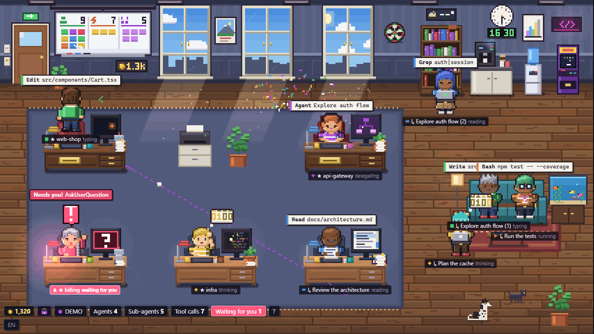
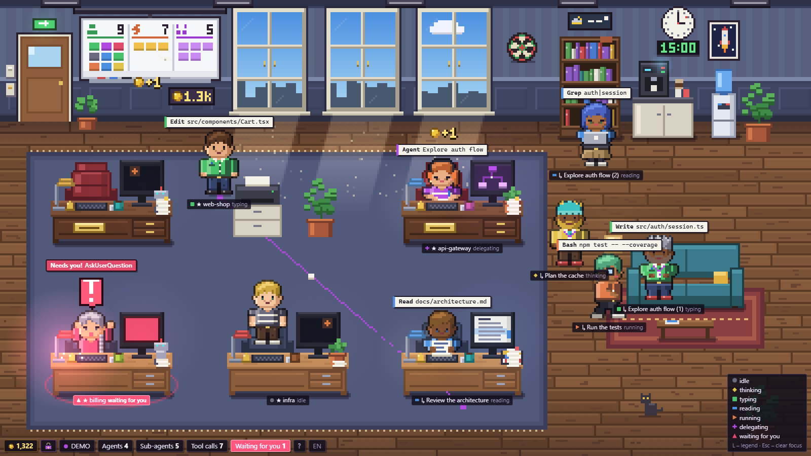
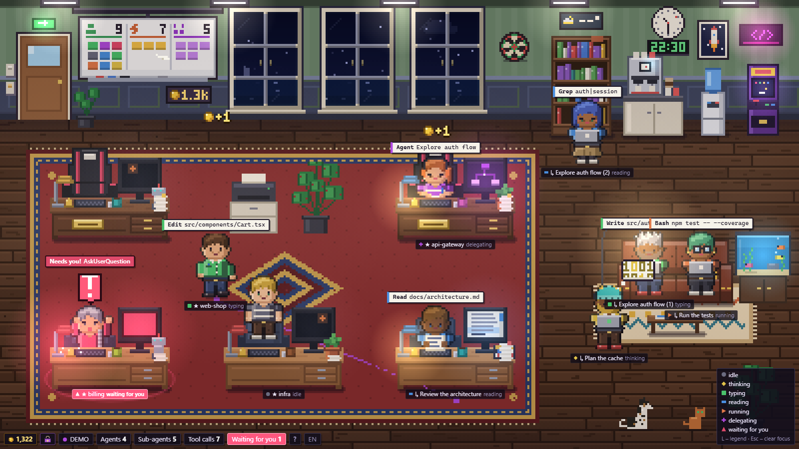
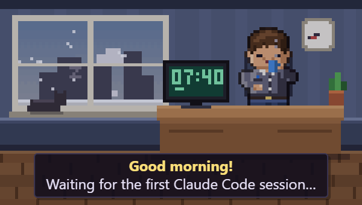

<div align="center">


### Your Claude Code agents, living in a tiny pixel-art office.

Every Claude Code session becomes a coworker at a desk – and so does every **Codex**, **Gemini CLI** and **OpenCode** session. **Copilot CLI, Cursor or any script** can walk in too through a small local API ([docs/api.md](docs/api.md)). Sub-agents walk in through the door, pick up the task
and sit down with their team. When someone needs you, the whole room lets you know.

[**🕹 Try the live demo in your browser**](https://rezored.github.io/cubicle-crew/) · [**▶ Watch the trailer**](https://rezored.github.io/cubicle-crew/media/trailer.mp4) · [**⬇ Download**](https://github.com/rezored/cubicle-crew/releases/latest) · [Quick start](#quick-start) · [How it works](#how-it-works)

[](https://github.com/hesreallyhim/awesome-claude-code)

<a href="https://rezored.github.io/cubicle-crew/"></a>

</div>

---

## Why

Claude Code is happiest when it runs a few sessions at once and hands work to sub-agents. That gets hard to follow
from a stack of terminal tabs: who is still busy, who is stuck on a question, who quietly finished ten minutes ago?

Cubicle Crew reads the session logs Claude Code already writes to `~/.claude/projects` and turns them into a live
scene you can leave open on a second monitor, or pin in the corner of your screen as a widget.

- **One look tells you the state of everything.** Each agent's shirt, monitor glow and name tag take the colour of what it is doing.
- **Delegation you can actually see.** Orchestrators walk over and hand paper to their sub-agents. Dotted lines on the floor show who works for whom.
- **You never miss a question.** An agent waiting on you (an `AskUserQuestion`, or an "Allow Bash?" permission prompt) waves, its tag flashes red with "Allow Bash?", a little chime plays if you're looking at another window, and the desktop app sends a Windows notification.
- **Nothing to set up.** No API keys and no hooks to install. It runs offline and only reads local files.

<p align="center">
  
  
</p>

## Features

| | |
|---|---|
| 🧑‍💻 **Teams** | Two lead desks with a ★ nameplate share one rug, with three desks for sub-agents below. Any sub-agent takes any free desk; the ones without a desk work on a laptop on the sofa until one frees up. Each team has its own mug colour, and lines connect every lead to its sub-agents. A third session works from the lounge until a lead desk is free. |
| 🔌 **Any agent, one endpoint** | `POST http://127.0.0.1:4317/api/event` (local only) brings anything into the office: ready-made hook configs for **GitHub Copilot CLI** and **Cursor**, any agent with Claude-Code-style hooks, or a script with `curl` / `npx cubicle-crew event tool_start --agent build --tool Bash --detail "npm test"`. They get a desk, a bubble with the current tool, turn red when they wait for you and walk out when they end. See [docs/api.md](docs/api.md). |
| 📄 **Context on the desk** | A stack of paper on every desk grows with the agent's context window, gets a yellow and then a red sticker as it fills up, and flies off the desk when the conversation is compacted. The card shows the exact numbers. Works for Claude Code, Codex and OpenCode. |
| ✅ **Allow / Deny from the office** *(optional)* | Turn on **Answer permission prompts here** in the `?` panel and Claude Code's "Allow …?" questions show up as a bar at the bottom of the office with **Allow** and **Deny** buttons (keys `Y` / `N`; in the desktop app also `Ctrl+Alt+Y` / `Ctrl+Alt+N` from any window). It adds one hook to `~/.claude/settings.json` (a backup is kept) and removes it when you turn it off. The terminal keeps working: if you don't answer in the office within 45 s, or you answer in the terminal, nothing changes there. |
| ⚠️ **Risky commands in red** | Shell commands that delete recursively, rewrite git history or touch production (`rm -rf`, `Remove-Item -Recurse -Force`, force push, `git reset --hard`, `terraform apply`, `kubectl delete`, `DROP TABLE`, `curl … \| sh`, anything with "prod") get a red ⚠ in the bubble, the card, the thin strip and the Allow / Deny bar, so you look twice before you allow them. |
| 💥 **Crashed sessions** | If a Claude Code session closes in the middle of a tool (a crash, a killed terminal), its agent doesn't just walk out: it stays at the desk in grey with a "Session ended" bubble until you hover or click it. |
| 🎨 **7 states** | `idle` · `thinking` · `typing` · `reading` · `running` · `delegating` · `waiting`. Each one has its own poses, monitor content and particles. |
| 🛋️ **Lounge** | Idle sessions grab a coffee, play handheld games on the sofa, doze off or throw darts. Up to three pets roam the lounge: cats with coat patterns and a dog (beagle, golden, corgi, husky, dachshund…) that likes to sit next to whoever is resting. Hover a pet to see its name; click it to rename it. |
| 🌇 **Real sky** | The tall French windows follow the clock of your city (or your computer's clock): dawn, golden hour, night. Lamps, monitors and the neon sign glow after dark, and the ceiling lights come on in the evening. The switch next to the door turns them off, for colleagues who like working in a cave. |
| 🌧️ **Real weather** *(optional)* | Pick your city in the shop's **Weather** tab (or click the little weather station above the bookshelf) and the windows show the weather outside: clouds, rain running down the glass, snow on the ledge, fog, lightning. The room gets darker on grey days, and the station shows the temperature and the chance of rain. Data comes from [Open-Meteo](https://open-meteo.com) every 20 minutes; only the city's coordinates are sent. Until you pick a city, the app makes no requests to the internet at all. |
| 🪙 **Coins & shop** | Active agents earn coins. Spend them on ~50 decor items: floors, walls, rugs, sofas, a throne for the lead, a neon sign, an aquarium, an arcade cabinet, more cats, a dog and its breeds, nine cat coat patterns. There are also 14 achievements. |
| 🧍 **Your avatar** | Pick a man or a woman, the hairstyle, top (and skirt, trousers or dress for a woman), skin, hair colour and glasses of your own character: the first orchestrator in the office. Everyone else stays random (men and women, different hair, clothes, beards, skirts and dresses). |
| 🧘 **Focus mode & privacy** | One switch (the `?` button or the tray menu) turns off the coins, shop, pets, particles and games, leaving just who is doing what and who is waiting for you. **Hide commands and paths** keeps bubbles to the tool name, for screen sharing and streaming. The `?` panel also explains every state; each one has its own dot shape as well as a colour. Click an orchestrator to give its session a name. |
| ↗️ **Jump to the terminal** | Double-click an agent (or use its card, the strip, or the "waiting for you" notification) and the window where that session runs comes to the front: Windows Terminal, VS Code, JetBrains, Terminal.app, iTerm. |
| 📊 **Your stats** | Work time by state, how long agents waited for you, tool calls and the real token usage from the transcripts, per day and project, plus what it would cost at Claude API prices (by model, with cache reads and writes – on a Pro/Max plan you don't pay per token, but it shows what the work is worth), with CSV/JSON export. Stored only on your computer. Click the whiteboard: one of your leads walks over, points the remote and a projector screen rolls down with today's numbers; click again for the last 7 and 30 days. Clicking an agent also shows its last actions. |
| 🎬 **Share** | A crisp PNG snapshot or a 10-second MP4 clip of the office from the `?` panel. `?overlay` gives a clean scene for an OBS browser source, with commands and paths hidden. |
| 🎃 **Seasonal decor & pets** | Pumpkins in autumn, a tree at Christmas, tulips in spring, a fan in summer – sold only in season, yours forever. Click a pet to pet it. |
| 🐧 **WSL, Docker, Cowork** | On Windows the app also watches `~/.claude/projects` inside running WSL distros. Claude Code in Docker or a VM shows up too once you mount its `~/.claude` to a folder and add it in the settings ([how](docs/docker.md)). Cowork tasks in Claude Desktop are found by themselves. |
| 🔔 **Sound** | An 8-bit ding-dong when an agent needs you (a question or a permission prompt) and a short fanfare when a session finishes after a minute or more of work. It only plays while you're looking at another window, and the bell in the bottom bar (or the tray menu) mutes it. In a browser it starts working after your first click on the page. |
| 🖥️ **Desktop widget** | A frameless, always-on-top Windows app above the tray, with a tray menu, `Ctrl+Alt+P`, notifications and start with Windows. |
| 🧩 **Moddable art** | Everything is drawn in code, but you can replace it with your own PNG character sheet and tileset without touching any code. |

## Quick start

Requires **Node.js 18+**. The fastest way – no install, opens in your browser:

```bash
npx cubicle-crew     # → http://localhost:4317   (--demo, --port 4400, --no-open)
```

Or from the source:

```bash
git clone https://github.com/rezored/cubicle-crew.git
cd cubicle-crew
npm install
npm start            # → http://localhost:4317
```

If port `4317` is already taken by another program (it is also the default port of the
OpenTelemetry Collector), the server falls back to `4318`–`4320` and prints the address
it actually used — open the URL from the console, not `4317`. `PORT=` picks a fixed one.

The first time you open it, a short setup asks whether the office starts with a cat or a dog (and its name) and which city you are in, for the clock and the weather. Both can be skipped and changed later in the shop.

Then start a Claude Code session anywhere. Its coworker walks in through the door.

No sessions running? The same simulation runs online at **[rezored.github.io/cubicle-crew](https://rezored.github.io/cubicle-crew/)** (made-up agents, nothing is installed or read). Locally there are more:

| URL | What you get |
|---|---|
| `/?demo` | Live simulation: two teams delegating, sessions coming and going, every state |
| `/?demo=showcase` | A frozen showcase with two teams, two queued sessions and all 7 states at once (good for screenshots) |
| `/?demo&agents=1` | Simulation with a single orchestrator |
| `/?time=22:30` | Fake the clock to see the office at night |
| `/?debug` | FPS, layout info and a log of the last events |
| `/?atlas=6` | Every generated character sprite at ×6 |

Environment variables: `PORT` (default `4317`), `CLAUDE_PROJECTS_DIR` (default `~/.claude/projects`),
`CLAUDE_SESSIONS_DIR`, `PIXEL_OFFICE_HOME` (where the save file lives, default `~/.pixel-office`).
`npm run debug` prints every parsed event and how each sub-agent was linked to its parent.

**Controls:** hover a character for details, click to focus it (spotlight and info card), `L` toggles the legend,
`B` opens the shop and `Esc` clears the focus.

**Language:** English or Bulgarian. It follows your system language. To switch, click the `EN`/`БГ` chip in the HUD, add `?lang=en` or `?lang=bg` to the URL, or use the tray menu in the desktop app.

## Desktop widget (Windows)

**Easiest:** grab `CubicleCrew-Setup-<version>.exe` from the [latest release](https://github.com/rezored/cubicle-crew/releases/latest) and run it.

The installer isn't code-signed (Cubicle Crew is a free side project), so Windows may show **"Windows protected your PC"** the first time. Click **More info**, then **Run anyway**. It's the same file as in this repository's releases, and [docs/security.md](docs/security.md) lists everything the app reads, writes and sends.

From source:

```bash
npm run desktop      # run the Electron app from source
npm run dist         # build the installer → release/CubicleCrew-Setup-<version>.exe
```

The widget runs its own server, so you don't need a browser or `npm start`. It sits in the bottom-right corner above
the tray and stays on top of other windows. Hover it to show a drag bar with settings, pin, click-through, hide and
quit buttons.
`Ctrl+Alt+P` shows or hides it from anywhere. The tray menu has notifications, sound, start with Windows, demo mode and size reset.

The installed app starts with Windows by default. Whenever it starts and no Claude Code session is open yet, it waits in a small window above the tray with a morning scene (your avatar with a coffee, your pet asleep on the sill, the sky at the real time of day); when a session appears, or you click it, it opens into the full office, and a minute after the last session closes it goes back to the small window. You can turn off either part in the tray menu: **Start with Windows** and **Small window until the first session**.

<p align="center">
  
</p>


## Desktop widget (macOS)

Needs macOS 13 Ventura or later. The easiest way is Homebrew:

```bash
brew install --cask rezored/tap/cubicle-crew
```

It opens without the extra security steps below (the cask removes the quarantine flag); `brew upgrade --cask cubicle-crew` updates it.

Or grab `CubicleCrew-<version>-mac.dmg` from the [latest release](https://github.com/rezored/cubicle-crew/releases/latest) (one build for Apple Silicon and Intel), open it and drag **Cubicle Crew** to Applications.

The app isn't signed with an Apple Developer ID yet, so a first launch from the `.dmg` needs one extra step: right-click the app → **Open** → **Open**. On macOS 15 and later: open it once, then **System Settings → Privacy & Security → Open Anyway**. If macOS says the app "is damaged", run `xattr -cr "/Applications/Cubicle Crew.app"` once.

On a Mac the widget lives in the menu bar (no Dock icon), opens at the top right under the menu bar, follows you across desktops, and does **not** start at login unless you tick **Start at login** in its menu. `⌘⌥P` shows or hides it. Notifications, the strip, Focus mode and "jump to the terminal" (Terminal, iTerm, VS Code…) work the same as on Windows.

## Desktop widget (Linux)

Grab `CubicleCrew-<version>-linux.AppImage` from the [latest release](https://github.com/rezored/cubicle-crew/releases/latest), make it executable (`chmod +x`) and run it. Everything works as on Windows except "jump to the terminal" and starting at login, which aren't supported on Linux yet. The tray icon needs a desktop with tray support (on GNOME, the AppIndicator extension).

## Settings

Everything is in the **settings panel** inside the window – the `?` button in the bottom bar, the `?` key, the ⚙ button on the app's title bar, or **Settings and help…** in the tray menu. It has six sections (Look, Alerts, Privacy & data, Window, Share, Help), and every option has a one-line description. The tray menu itself stays short: show/hide, shop, stats, weather, the thin strip, click-through (the only way back once clicks go through) and quit.

**Look**
- **Office** – the whole game: coins and the shop, pets, coffee breaks, handheld games and darts, effects and achievements.
- **Focus** – a quiet status board: no coins, shop, pets, effects or games. You still see who is doing what and who is waiting for you. Coins keep adding up, just hidden.
- **Thin strip instead of the office** *(app)* – one row per session: state, what it is doing, for how long. Takes the least space; click a row to jump to its terminal.
- **Colour legend** – the list at the bottom right with the state names (key `L`).
- **Office lights** – the ceiling lights come on in the evening. There is also a switch by the door – for colleagues who like working in a cave.
- **Language** – English or Bulgarian.

**Alerts**
- **Answer permission prompts here** – adds a small hook to the Claude Code settings (`~/.claude/settings.json`, a backup is kept). When Claude asks “Allow …?”, Allow / Deny buttons appear at the bottom (keys `Y` / `N`). The terminal works as before; if you do not answer here within 45 s the question stays there. Turning it off removes the hook.
- **Sound** – a short tune when an agent waits for you or finishes a long task, only when you are not looking at the window.
- **System notification** *(app)* – a pop-up when an agent waits for you; clicking it opens that session's terminal.

**Updates**
- **Check for new versions** – off by default. Every 6 hours (or with "Check now" in the panel) asks GitHub for the latest release number; when there is a newer one, the `?` button gets a green dot and the panel (and the tray menu in the app) shows a download link. In the Windows app the panel and the tray also offer **Download and install**: one click downloads the installer from the GitHub release, checks its SHA-256 and installs it over the current version (coins and settings stay), then the app restarts. Nothing is downloaded or installed until you click it.

**Privacy**
- **Hide commands and paths** – bubbles, the card and notifications show only the tool and the session name. For screen sharing and streaming.
- **Phone view** – off by default. Watch the office from your phone on the same Wi-Fi: the panel shows the address and a 6-digit PIN. View only – the server never sends commands, paths, task names or permission prompts to the phone. It opens a port on your local network (Windows may ask about the firewall); details in [docs/security.md](docs/security.md#phone-view-optional-off-by-default).
- **More agent folders** – for Claude Code in Docker, a VM or on another drive: add the folder mounted as its `~/.claude`, and its sessions walk into the office like local ones, including "waiting for you". Step by step with `docker run`, compose and Dev Containers: [docs/docker.md](docs/docker.md). Cowork tasks from Claude Desktop are picked up automatically.

**Window** *(app)*
- **Show only when needed** – the window stays hidden (the tray icon stays) and comes up by itself, without taking focus, when an agent waits for you or a lead finishes; it hides again 8 s later. Ctrl+Alt+P or the tray icon show it any time.
- **Always on top** – the window stays above the others, so you see the office while you work.
- **Click-through** – the mouse goes through the office to whatever is below. Turn it off from the tray menu.
- **Taskbar button** – off by default; the app also shows up on the taskbar, not only by the clock (Windows and Linux).
- **Small window when there are no sessions** – with no session open the office shrinks to a morning scene and opens by itself when a session starts.
- **Start with Windows / Start at login** – Cubicle Crew starts by itself when you sign in.
- **Demo mode** – made-up agents, to see how everything looks without Claude Code.

## Feedback

Cubicle Crew is a free side project and grows from what people say. Ideas and questions go to [GitHub Discussions](https://github.com/rezored/cubicle-crew/discussions), bugs to [Issues](https://github.com/rezored/cubicle-crew/issues). The `?` panel links to both.

If Cubicle Crew saves you time, you can [buy me a coffee](https://buymeacoffee.com/rezored) ☕ – it stays free either way.

## How it works

Everything stays on your machine. [docs/security.md](docs/security.md) lists exactly what the app reads, writes and sends.

```
~/.claude/projects/**/*.jsonl  ──tail──▶  server.js  ──WebSocket──▶  browser / Electron
~/.claude/sessions/<pid>.json  ──poll──▶     │                         │
~/.codex/sessions/**/*.jsonl   ──tail──▶     │
~/.gemini/tmp/*/chats/*.jsonl  ──tail──▶     │
opencode.db (read-only)        ──poll──▶     │
                                         wallet.js                  canvas scene
                                  (~/.pixel-office/save.json)     (vanilla ES modules)
```

- **Server** (`server.js`): polls transcripts touched in the last hour and turns each line into small events
  (`tool_start`, `tool_end`, `say`, `user_prompt`). It links sub-agents to their parent through
  `subagents/agent-<id>.meta.json` first, then the session id, then a timing heuristic. It also reads
  `~/.claude/sessions` every second to know which sessions are still open, which are busy and which are waiting for you. Old history isn't replayed on start.
- **Codex, Gemini CLI and OpenCode** (`providers.js`): Codex rollout files and Gemini CLI chat logs are tailed like Claude Code transcripts (Gemini's sub-agents come in as sub-agents); shell commands are sorted into reading (`rg`, `cat`, `Get-Content`…) and running, `apply_patch` is typing. OpenCode's SQLite database is read once a second (read-only), and its sub-sessions (the `task` tool) walk in as sub-agents. Their labels say `· Codex` / `· Gemini` / `· OpenCode`. They have no live-session file, so they don't turn red on permission prompts yet, and "Jump to the terminal" works only for Claude Code.
- **Tool → state:** `Edit`/`Write` → typing, `Read`/`Grep`/`WebFetch` → reading, `Bash` → running,
  `Task`/`Agent` → delegating, `AskUserQuestion` → waiting. 8 seconds of silence → idle, unless Claude Code still reports the session as busy (it's thinking or writing a long reply). You can change the mapping in `public/rules.js`.
- **Permission prompts** never reach the transcript, but Claude Code marks the session as `waiting` (`waitingFor: "permission prompt"`)
  while one is on screen. The agent that started the last tool turns red until you answer, and goes back to work the moment you click Allow.
- **Client** (`public/`): plain ES modules with no build step. The scene is drawn on a low-resolution canvas and scaled
  up by whole device pixels, so it stays crisp at any DPI. All text is HTML laid over the canvas.
- **Tokens:** earned on the server every 5 seconds: about 1 per active orchestrator minute, half for sub-agents,
  plus bonuses for finished tasks. Even if several Cubicle Crew windows are open, only one of them counts.
  The save file is written atomically and keeps a backup.

The WebSocket protocol and module map are documented in [`CLAUDE.md`](CLAUDE.md). The token economy and shop design
are in [`docs/gamification.md`](docs/gamification.md).

## How is this different from Pixel Agents?

[Pixel Agents](https://github.com/pixel-agents-hq/pixel-agents) is a great VS Code extension with a similar idea. Cubicle Crew goes in a different direction:

- **Standalone.** It runs as a desktop widget or in any browser, next to whatever editor or terminal you use, with no VS Code required.
- **A small idle game.** Your agents earn coins, and you spend them on furniture, pets and decor. There are also achievements and an avatar.
- **The office reacts to your whole setup.** Teams per session, a queue in the lounge when more than two sessions work, and a day/night sky that follows your local clock.
- **Zero assets.** Every sprite and piece of furniture is drawn in code, so there's nothing to buy or download, and you can still drop in your own tileset.

## Custom sprites

Drop PNGs into `public/sprites/` and reload the page:

- **`characters.png`**: 24×32 cells, one row per pose in the order of `POSE_ORDER` in `sprites.js` (open `/?atlas` to get a ready-made template).
  Paint the shirt in the key colours `#ff80ff` / `#ff00ff` / `#a000a0` and they get recoloured with the state colour.
- **`tiles.png` + `tiles.json`**: map `name → {x, y, w, h}` for furniture and floors (`desk`, `chair`, `monitor`, `sofa_back`, …).
  For a shop item that isn't the default, use `name@itemId` (for example `sofa_back@sofa.chesterfield`). Anything you don't provide stays procedural.

## Known limitations

- The JSONL transcript format isn't an official API. If parsing ever breaks, `npm run debug` shows what's happening.
- Without the session status (older Claude Code versions), an agent counts as idle after 8 seconds without new transcript lines, so long thinking looks like a break.
- Permission prompts are only seen through the session status, so older Claude Code versions that don't write it only show `waiting` for `AskUserQuestion`.
- Installers exist for Windows x64, macOS (universal) and Linux (AppImage, x64). None is code-signed – the app is a free side project – so Windows and macOS ask once on first launch. Jumping to the terminal and starting at login aren't supported on Linux yet.

## Tech

Node.js, the [`ws`](https://github.com/websockets/ws) library and Electron for the desktop build. That's all.
There are no image assets, fonts, CDNs or frameworks: every pixel, from the characters to the aquarium fish, is drawn in code.

## Contributing

Issues and pull requests are welcome – see [CONTRIBUTING.md](CONTRIBUTING.md). Contributors can get an office pet of their own design, free in the shop with their name on it.

**Contributor pets:** Bueno, the tricolour mix – [@buensoft](https://github.com/buensoft).

**Contributor decor:** the "Beer & metal" neon sign – Ivan Turtev.

## License

[MIT](LICENSE) © Kalin Dimitrov

<sub>Formerly “Pixel Office”. Not affiliated with Anthropic. "Claude" and "Claude Code" are trademarks of Anthropic.</sub>
